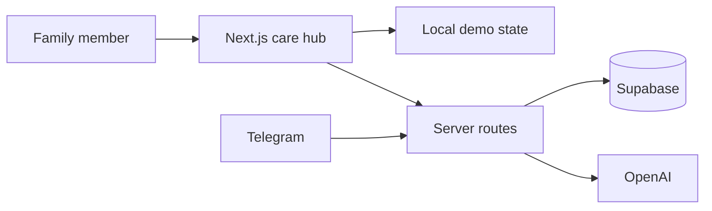

# Tandem

Tandem is a family-caregiving coordination prototype built collaboratively for
Build for Good by Nathaniel, James, Daniel, and Chime. Relatives can share care
updates, divide follow-up tasks, and prepare a structured handover when another
caregiver takes over.

The local demo combines seeded care data with mock AI responses. Optional
Supabase, OpenAI, and Telegram integrations explore shared profiles, document
capture, and reviewable task extraction.

[Live prototype](https://tandem-nu-five.vercel.app) · [Local setup](#local-setup) · [Version history](docs/versions.md) · [Demo briefing](docs/tandem-hackathon-judge-briefing.pdf)

## What is built

- A mobile-first care hub with a timeline, task ownership, and care-load views.
- Document, voice, and meeting capture that proposes records and tasks for review.
- A patient Health page with profile details and care-history Q&A that cites
  recorded timeline items.
- QR handover sessions with briefing, history, appointments, team, and checklist
  acknowledgments, followed by a Caregiver Wrapped view for real completions.
- A Telegram inbox for forwarded material and Save All or Ignore review.
- Partial English and Chinese labels in navigation, Settings, and onboarding.
  Most content remains English. Other language choices fall back to English;
  reload after changing the saved language.

## Stack and architecture

| Technology | Role in Tandem |
|---|---|
| Next.js App Router and TypeScript | One application holds care pages and server routes for capture, data access, and Telegram. Shared types describe the records passed between them. |
| React, Tailwind CSS, and shadcn/ui-style components | Build the mobile care hub, review forms, task views, and handover wizard. |
| Local state and localStorage | Keep the no-credentials demo usable and preserve local accounts and care sessions in the browser. |
| Supabase Auth, Postgres, and Storage | Add email-link sign-in, shared care records, and document storage through the live integration paths. |
| OpenAI and Zod | Server routes request structured extraction, meeting summaries, and care-history answers. Missing keys and handled provider failures return labeled mock output. |
| `qrcode.react` | Displays a handover payload as a QR code. The prototype's QR transport is separate from production access control. |
| Telegram Bot API | Receives forwarded text and files, links a sender to a care circle, and returns a review preview. |



The implementation explores the transition between a local demonstration and
shared caregiving data. That boundary is visible in
[`care-data-provider.tsx`](components/providers/care-data-provider.tsx),
which manages browser state and calls persistence routes in live mode.
The live paths remain incomplete; they do not establish production isolation
between care circles.

## Local setup

Use Node.js 22. Run the current application from the repository root:

```bash
git clone https://github.com/Neonat/tandem.git
cd tandem
npm ci
npm run dev
```

Open [localhost:3000](http://localhost:3000). Tap the **TANDEM** logo, then enter
a username. This creates or reopens a local browser account. It is separate
from Supabase authentication. With no credentials, the demo loads local seeded
data and mock AI responses.

The independent [nested prototype](tandem/README.md) is historical reference,
not another installation step. It has its own Next.js package, IndexedDB data,
and service worker. Use a separate origin if exploring that version.

### Configure live services

Create an uncommitted `.env.local` for the integrations you need:

```dotenv
NEXT_PUBLIC_SUPABASE_URL=
NEXT_PUBLIC_SUPABASE_ANON_KEY=
SUPABASE_SERVICE_ROLE_KEY=
OPENAI_API_KEY=
```

`SUPABASE_SERVICE_ROLE_KEY` is used in server routes and must remain out of
client code. Optional model overrides are `OPENAI_MODEL` and
`OPENAI_TRANSCRIBE_MODEL`; their source defaults are `gpt-5.5` and
`gpt-4o-mini-transcribe`. Model access and live output quality require separate
validation.

For Supabase:

1. Create a project and apply every SQL file in
   [`supabase/migrations/`](supabase/migrations/) in filename order.
2. Run [`supabase/seed.sql`](supabase/seed.sql).
3. Set all three Supabase variables above and restart the app.
4. Add `http://localhost:3000/auth/callback` and the deployed `/auth/callback`
   address to the project's Auth redirect URLs.
5. Request an email sign-in link in **Settings** and open that link.

The migrations define care circles, recipients, members, timeline records,
tasks, documents, capture records, Telegram links, signals, and legacy
handovers. They also create the private `documents` Storage bucket. Apply
all migrations, including the profile, relationship, and Telegram-linking
changes; the initial schema alone is insufficient.

Live sign-in provisions a `public.users` row. The Home selector reads a shared
care recipient, and profile edits use `/api/data/care-recipients/[recipientId]`.
The newer handover sessions and acknowledgments are managed by the client
provider and lack a complete shared persistence model.

### Configure Telegram capture

Set these values for the server deployment:

```dotenv
NEXT_PUBLIC_APP_URL=https://your-deployment.example
TELEGRAM_BOT_TOKEN=
TELEGRAM_WEBHOOK_SECRET=
TELEGRAM_BOT_USERNAME=
TELEGRAM_ALLOWED_USER_IDS=
```

Create a bot with Telegram's `@BotFather`. Register
`<NEXT_PUBLIC_APP_URL>/api/telegram/webhook` as its webhook, with
`TELEGRAM_WEBHOOK_SECRET` as the secret token. A deployment must be reachable
by Telegram. The optional username avoids a bot lookup; the optional allow-list
accepts comma-separated numeric sender IDs.

In a signed-in Tandem account, use **Settings > Connect Telegram** to create a
short-lived `/start <token>` link for the active care recipient. Accepted
forwarded material is attached to that user's care circle. The bot stores the
source, extracts proposed care records, and returns Save All or Ignore actions.
Pending items appear in `/inbox`.

Suggested bot commands are `start`, `status`, `recipient`, and `unlink`.
An allow-list does not replace account and care-circle linking.

## Demo walkthrough

1. Enter `Sarah` at the splash, select **Mum**, and choose **Begin care**.
2. Review the timeline, open **Tasks**, and inspect the unclaimed transport task.
3. In **Capture**, use the demo memo and review the extracted summary and tasks.
4. Assign follow-up work and inspect **Care load**.
5. Open **Health**, inspect the profile, and ask about recorded vitals.
6. Generate a handover QR and choose **Simulate handover**. Acknowledge each
   wizard tab and complete the checklist.
7. Return to Health. Complete a real handover to see Caregiver Wrapped, then
   choose **End handover** to archive the session.
8. Use **Meeting** to turn meeting notes into proposed tasks.

Simulated completions skip Wrapped. The original one-page AI briefing remains
at `/handover/legacy`. The [judge briefing](docs/tandem-hackathon-judge-briefing.pdf)
provides more presentation context.

## Checks

```bash
npm test
npm run typecheck
npm run lint
npm run build
```

The Node test runner covers calendar-day labels, task routing, and Telegram
parsing. The TypeScript and ESLint configurations exclude the nested historical
app. These checks do not validate a live Supabase deployment, provider output,
Telegram delivery, or a complete browser handover.

## Prototype limits

- Care-team permission toggles are UI state. Live care-circle isolation needs
  stricter row-level security, invite flows, and session-scoped API writes.
- Handover v2 sessions and acknowledgments do not have complete shared backend
  persistence. A local browser demonstration is not a cross-device guarantee.
- The QR helper uses a shared key embedded in client source. Its payload is a
  demo transport, not a secure invitation or authorization mechanism.
- Reassurance signals and parts of the demo are simulated.
- AI output needs human review before saving. Care-history answers are prompted
  to use supplied timeline data and return `not_found` when evidence is absent;
  live model adherence is not guaranteed by that prompt.
- Tandem coordinates care. It does not provide medical advice or clinical
  medication recommendations.

## Team and source history

Tandem is a collective Build for Good project by Nathaniel, James, Daniel, and
Chime. This public shared repository retains the project history and
collaborator access. It includes merged work from
[papermelon/tandem-app](https://github.com/papermelon/tandem-app).

[Version notes](docs/versions.md) explain the earlier local-first app, private
deployment snapshots, and preserved localization experiment. The snapshots
remain historical deployment copies, not separate products.

## License

This repository does not include a license file.
